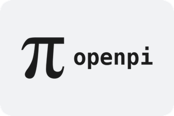
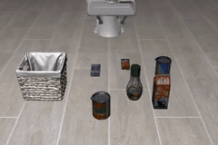
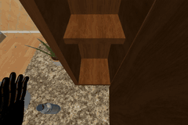
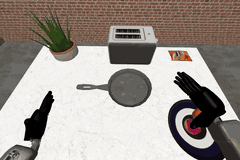
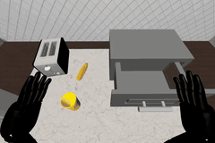
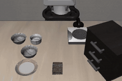

# hiVLA: A Unified Serving Layer for Deploying Diverse VLA Models

<div align="center">

**Author:** [The Humanoid Intelligence Team](https://humanoidintelligence.github.io)

[OpenMOSS Group](https://openmoss.ai) / [Shanghai Innovation Institute](https://www.sii.edu.cn/) / [Fudan University](https://www.fudan.edu.cn/en/)

**English** | [简体中文](./README.zh-CN.md) · **Docs:** [Model families](docs/families/README.md) · [API reference](docs/api.md) · [Changelog](CHANGELOG.md) · [Contributing](CONTRIBUTING.md)

<!-- families-gallery:start -->

<table>
<tr><td align="center"><a href="docs/families/lerobot.md"></a><br><sub>LeRobot</sub></td><td align="center"><a href="docs/families/openpi.md"></a><br><sub>openpi</sub></td><td align="center"><a href="docs/families/gr00t.md"></a><br><sub>GR00T</sub></td><td align="center"><a href="docs/families/starvla.md"></a><br><sub>StarVLA</sub></td><td align="center"><a href="docs/families/xpolicylab.md"></a><br><sub>XPolicyLab</sub></td><td align="center"><a href="docs/families/rlinf.md"></a><br><sub>RLinf</sub></td></tr>
<tr><td align="center"><a href="docs/families/lerobot.md"></a><br><sub>LIBERO</sub></td><td align="center"><a href="docs/families/openpi.md"></a><br><sub>LIBERO</sub></td><td align="center"><a href="docs/families/gr00t.md"></a><br><sub>RoboCasa GR-1</sub></td><td align="center"><a href="docs/families/starvla.md"></a><br><sub>RoboCasa GR-1</sub></td><td align="center"><a href="docs/families/xpolicylab.md"></a><br><sub>RoboCasa GR-1</sub></td><td align="center"><a href="docs/families/rlinf.md"></a><br><sub>LIBERO</sub></td></tr>
</table>

<!-- families-gallery:end -->

</div>

<!-- toc -->

<details>
<summary><b>Contents</b></summary>

- [Introduction](#introduction)
- [Supported models](#supported-models)
- [Quick start](#quick-start)
  - [Try it without a model](#try-it-without-a-model)
  - [Install for a real model](#install-for-a-real-model)
  - [Worked example: GR00T N1.6 on the Fourier GR-1](#worked-example-gr00t-n16-on-the-fourier-gr-1)
  - [Drive a hiRobot robot](#drive-a-hirobot-robot)
- [Architecture](#architecture)
- [Repository structure](#repository-structure)
- [Performance](#performance)
  - [A. One server](#a-one-server)
  - [B. Many servers behind `hivla route`](#b-many-servers-behind-hivla-route)
- [Add a new model](#add-a-new-model)
- [Contact](#contact)
- [Citation](#citation)
- [License](#license)

</details>

<!-- /toc -->

## Introduction

hiVLA serves vision-language-action (VLA) models over the network. You point it
at a checkpoint, start `hivla serve`, and a robot-side caller sends observations
(joint state, camera images, an instruction) and gets back a chunk of actions to
execute. Everything model-specific runs on the server: resizing, normalization,
tokenization, the forward pass, unnormalization, and splitting the output into
the action fields the robot understands.

- **One interface for many model families.** LeRobot, openpi (π₀ / π₀.₅),
  GR00T, StarVLA, XPolicyLab and RLinf models sit behind the same request and
  reply format, so the caller does not change when the model does. A `generic`
  family serves plain torch / ONNX / TensorRT checkpoints, and a new family is
  one adapter class.
- **One environment per model, started for you.** Each family keeps its own
  torch / jax versions in its own environment; `hivla launch` starts the server
  with that environment's Python from wherever you are.
- **Fits hiRobot's interface for many robots.** Requests and replies use
  [hiRobot](https://github.com/humanoidintelligence/hiRobot)'s `Observation`
  and `ActionChunk` fields, so a model and a robot meet through one interface.
  One VLA can serve several robots, with one config per robot that sets its
  state layout and action width: XPolicyLab's `demo_policy` ships configs for
  the Unitree G1 and dual UR5e arms. One robot can call several VLAs: the
  Fourier GR-1 in RoboCasa has run both GR00T N1.6 and StarVLA QwenGR00T
  through hiRobot.
- **Faster serving.** Dynamic batching of concurrent requests, a cache that
  replays the last chunk for a repeated observation, `torch.compile`, and an
  async engine that predicts the next chunk while the robot executes the current one.
- **Many GPUs behind one address.** `hivla route` load-balances a pool of
  servers (round-robin, least-outstanding, or consistent-hash for cache hits);
  a dead backend returns an error at once instead of hanging the caller.

hiVLA serves models. With [hiRobot](https://github.com/humanoidintelligence/hiRobot)
installed, `hivla.robot.run_episode` also runs a served model on a robot, in
simulation or on hardware; it is a minimal loop, and the full agent loop lives
in hiAgent.

> [!NOTE]
> **Companion projects.**
> [hiRobot](https://github.com/humanoidintelligence/hiRobot) is the robot side:
> one interface for different robots, which reads observations and checks every
> command. hiVLA's requests and replies use hiRobot's `Observation` and
> `ActionChunk` field names; only `hivla.robot` imports hiRobot, when it is called.
> [hiWBC](https://github.com/humanoidintelligence/hiWBC) handles whole-body
> balance and walking below hiRobot.
> [hiAgent](https://github.com/humanoidintelligence/hiAgent), the agentic
> operating layer, calls hiVLA through `hivla.client` inside its own loop and
> plays the returned chunks on hiRobot.

> [!WARNING]
> **Status: early development.** APIs are unstable and may change.
>
> **Safety on real robots.** The action chunks hiVLA serves reach a robot through
> hiRobot (from `hivla.robot` or hiAgent), and a robot under software control
> can injure people and damage itself. Read this repository carefully before running it on hardware,
> and hiRobot's [setup guide](https://github.com/humanoidintelligence/hiRobot/tree/main/docs/setup)
> for your robot.
> Debug in simulation until it works, then move to the real robot step by step:
> read-only first, then the robot hung on a gantry at low gains, with an e-stop
> within reach and nobody inside the robot's reach.

## Supported models

Each family runs the model through its own code and pre- / post-processing, so
results match the original release. hiVLA adds a common entry point around it.

| Family | Models | Built-in config | Verified | Guide |
| --- | --- | --- | --- | --- |
| `generic` | Any torch / ONNX / TensorRT checkpoint | `example` | | [generic](docs/families/generic.md) |
| `lerobot` | LeRobot **v0.6.2** single-observation policies such as ACT | `lerobot_act_aloha` | ACT ALOHA: chunk shapes over HTTP / WS | [lerobot](docs/families/lerobot.md) |
| `openpi` | π₀, π₀.₅, π₀-FAST from Physical Intelligence | `openpi_pi05_libero` | π₀.₅ LIBERO: 97.05% mean over 4 suites (openpi: 96.85%) | [openpi](docs/families/openpi.md) |
| `gr00t` | NVIDIA GR00T **N1.6** / N1.7 | `gr00t_n1d6_gr1` | N1.6 RoboCasa GR-1: 5 / 10 episodes | [gr00t](docs/families/gr00t.md) |
| `starvla` | StarVLA `baseframework` checkpoints (QwenGR00T, QwenOFT, ...) | `starvla_qwengr00t_gr1` | QwenGR00T RoboCasa GR-1: 37 / 50 (StarVLA: 0.58–0.74) | [starvla](docs/families/starvla.md) |
| `xpolicylab` | Any XPolicyLab policy (stateful) | `xpolicylab_demo_g1` | `demo_policy` on the MuJoCo G1 | [xpolicylab](docs/families/xpolicylab.md) |
| `rlinf` | π₀ / π₀.₅ in RLinf's PyTorch reimplementation | `rlinf_pi05_libero` | Pi05-LIBERO-SFT ran LIBERO spatial | [rlinf](docs/families/rlinf.md) |

Each guide covers the environment, the config keys, how observation fields
reach the model and how its output comes back, and common pitfalls. The
[family index](docs/families/README.md) has the general workflow.

## Quick start

### Try it without a model

The `echo` backend returns a zero action chunk, so you can try the server and
the client with no checkpoint, GPU, or deep-learning stack:

```bash
git clone https://github.com/humanoidintelligence/hiVLA.git && cd hiVLA
pip install -e ".[server,client]"
hivla serve --config echo_example         # HTTP + WebSocket on :8000
```

From another shell:

```bash
curl localhost:8000/health      # {"status":"ok"}
curl localhost:8000/metadata    # what the model expects and returns
```

```python
import numpy as np
from hivla.client import VlaClient

client = VlaClient("http://localhost:8000")
client.reset()                  # fetches /metadata into client.metadata
chunk = client.act({
    "joint_pos": np.zeros(7, np.float32),
    "images": {"head": np.zeros((224, 224, 3), np.uint8)},
    "instruction": "pick up the cube",
})
print(chunk["mode"], chunk["joint_targets"].shape)   # position (16, 7)
```

`VlaWsClient` has the same methods over one persistent WebSocket connection.
`reset()` also starts an episode on the server, which a stateful model
(XPolicyLab) needs before the first `act`.
The observation fields and the chunk fields are listed in the
[API reference](docs/api.md#wire-format).

### Install for a real model

Each model family pins its own torch / transformers versions, and they conflict
with each other. So hiVLA does not bring a deep-learning stack: you install it
as a light library **into the model's own environment**, and run one server per
model. Pick the extras you need:

| Extra | Adds |
| --- | --- |
| `server` | `hivla serve` and `hivla route` (FastAPI, uvicorn) |
| `client` | `hivla.client` and the `remote` backend (httpx, websockets) |
| `torch` / `onnx` / `tensorrt` | The `generic` family's backends |
| `vision` | Image resizing with Pillow |
| `dev` | pytest and ruff |

The server does not have to be started from the model's environment.
`hivla launch` reads `launch.env` from the config (a conda env name, an env
prefix or a Python path), checks that hiVLA imports there and the port is free,
starts `hivla serve` with that Python and waits until `/health` answers:

```yaml
launch:
  env: gr00tn1d6           # the model's environment
  ready_timeout: 600       # seconds to wait for /health
```

```bash
hivla launch --config <model>             # from any env with hiVLA
```

Each family's environment and checkpoint are described in its
[guide](docs/families/README.md).

### Worked example: GR00T N1.6 on the Fourier GR-1

This serves NVIDIA's GR00T N1.6-3B for the Fourier GR-1 humanoid (embodiment
tag `gr1`), starting from a fresh clone.

**1. Install into a GR00T environment.** Set up
[Isaac-GR00T](https://github.com/NVIDIA/Isaac-GR00T) n1.6 by its instructions
(Python 3.12, torch 2.7.1+cu128), then add the Eagle backbone's `flash-attn` and
hiVLA into that same environment:

```bash
git clone https://github.com/humanoidintelligence/hiVLA.git && cd hiVLA
conda activate gr00tn1d6                              # your GR00T environment
pip install flash-attn --no-build-isolation          # the Eagle backbone needs it
pip install -e ".[server,client]"
```

**2. Download the checkpoint** from Hugging Face. GR00T's VLM backbone is gated,
so first request access to
[`nvidia/GR00T-N1.6-3B`](https://huggingface.co/nvidia/GR00T-N1.6-3B) and log in
with `hf auth login`:

```bash
export HIVLA_MODELS=/path/to/your/models
hf download nvidia/GR00T-N1.6-3B --local-dir $HIVLA_MODELS/Isaac-GR00T-n1.6/checkpoints/GR00T-N1.6-3B
```

`src/hivla/configs/gr00t_n1d6_gr1.yaml` reads the checkpoint path from `${HIVLA_MODELS}`.
Configs expand `~`, `$VAR`, `${VAR}` and `${VAR:-default}`, so they hold no
machine-specific paths. An unset variable without a default is an error, so a
path can't silently point at the wrong place.

**3. Check the config, then serve.** `hivla inspect` resolves the config without
loading weights:

```bash
hivla inspect --config gr00t_n1d6_gr1     # prints what will be served
hivla serve   --config gr00t_n1d6_gr1     # loads GR00T on the GPU, listens on :8000
```

**4. Check that it answers**, from another shell:

```bash
curl localhost:8000/health        # {"status":"ok"}
curl localhost:8000/metadata      # action_dim 29, cameras, action_horizon, ...
```

To test the model without a running server, `scripts/smoke_gr00t_n1d6.py`
loads it in-process, sends synthetic observations and checks every chunk's
shape (`--http` / `--ws` go through a local server it starts itself):

```bash
python scripts/smoke_gr00t_n1d6.py --config gr00t_n1d6_gr1 --iters 10
```

**5. Drive a robot with it**, with `hivla.robot` (next section) or through
hiAgent: set `vla.endpoint` in a hiAgent robot config to `http://<host>:8000`.
See hiAgent's [quick start](https://github.com/humanoidintelligence/hiAgent#quick-start).

The other families work the same way, each in its own environment with its own
built-in config (`hivla configs` lists them); their [guides](docs/families/README.md) list the
steps. Each config reads its checkpoint from an environment variable you must
set: `gr00t` and `starvla` from `${HIVLA_MODELS}`, `openpi` from
`${OPENPI_DATA_HOME}`, `rlinf` from `${RLINF_CKPT}` (and `${OPENPI_DATA_HOME}`
for its tokenizer).

### Drive a hiRobot robot

`hivla.robot.run_episode` runs a served model on a hiRobot `Robot`. The robot's
environment needs hiRobot and `hivla[client]`, none of the model's packages:

```python
from hirobot import make_robot
from hivla.client import VlaWsClient
from hivla.robot import run_episode

robot = make_robot("unitree_g1_mujoco", sim=True)
result = run_episode(robot, VlaWsClient("http://127.0.0.1:8012"), max_steps=100,
                     instruction="wave")
print(result.steps, result.chunks, result.stopped_by)   # 100 50 max_steps
```

It resets the robot and the server, asks for a chunk, sends its steps with
`send_action`, and asks again after the server's `n_action_steps`. For a
model that reads every executed step (`observe: every_step` in `/metadata`) it
sends an `observe` before each further step. A real robot is paced at its
`control_hz`; a simulator steps as fast as it runs. On an exception the robot
is told to `hold()` before the error is raised.

To try it with no weights, serve XPolicyLab's `demo_policy` for the MuJoCo G1
(`src/hivla/configs/xpolicylab_demo_g1.yaml`, see the [XPolicyLab guide](docs/families/xpolicylab.md))
and run the code above from hiRobot's environment.

## Architecture

The caller sends a plain observation and gets back a ready-to-run action chunk.
All model-specific processing happens on the server, the same split openpi and
GR00T use for their own deployments. The caller's client
does not change when you switch models, and it needs only numpy plus an HTTP /
WebSocket library (`hivla[client]`), none of the model's dependencies.

![hiVLA architecture, drawn like a server: the model on top, callers at the bottom, and a request travelling up. On top, the model code (lerobot, openpi, Isaac-GR00T, starVLA, XPolicyLab, RLinf) and checkpoints that the backends load. Inside hiVLA, from the top: the ModelBackend (native families lerobot, openpi, gr00t, starvla, xpolicylab, rlinf in their own env, or generic on the runtimes torch, onnx, tensorrt, echo, remote), VlaPolicy (input transforms ConcatState, RenameKeys and the family's transforms, the backend, then the family's output transforms, RenameKeys, GripperToOpening and the chunk check against hiRobot's ActionChunk rules), the InferenceEngine (observation cache, dynamic batching, one session at a time for a stateful model), the Server (/act, /reset, /observe, /ws, /metadata, /health, optional api_key), the network (JSON or msgpack, no pickle) and hivla.client (in the caller; numpy only; hivla.robot drives a hiRobot Robot with it). On the right, configs/*.yaml (a path or a built-in name) become a ModelSpec, a FamilyAdapter and build_engine, which builds the stack; beside it /metadata, hivla.protocol, hivla inspect and AsyncInferenceEngine. On the left, one env per family (hivla launch starts it from any env) and the optional hivla route gateway in front of a pool. At the bottom, hiAgent sends observations to hiVLA over the network and gets action chunks back, and exchanges Action and Observation with hiRobot in-process; hiVLA follows hiRobot's field names and rules without importing it.](assets/architecture.png)

Read the diagram from the bottom up, the way a request travels:

1. **`hivla.client`** (`VlaClient` over HTTP, `VlaWsClient` over WebSocket)
   encodes the observation and sends it, as JSON (arrays in base64) or msgpack
   (arrays as raw bytes). Nothing is pickled.
2. **`Server`** receives it on `/act` or `/ws`. `/metadata` tells the caller what
   the model expects and returns (cameras, state layout, joint names, action
   horizon, whether it is stateful) and `/health` is for probes. `/reset` starts
   an episode and `/observe` hands a stateful model one observation without
   asking for a chunk. With `server.api_key` set, `/act`, `/reset` and
   `/observe` require the key; `/ws` does not check it yet, so keep the port on
   a trusted network.
3. **`InferenceEngine`** replays the cached chunk if the observation repeats,
   and groups concurrent requests into one batch. For a stateful model it
   instead serves one session at a time: the one that called `reset` last
   (an HTTP client's `X-Hivla-Session` header, or one WebSocket connection).
   `AsyncInferenceEngine` is the in-process variant that predicts the next chunk
   in the background.
4. **`VlaPolicy`** runs the input transforms, the backend, then the output
   transforms. It finally checks that the chunk is one hiRobot can execute:
   a known control mode, consistent shapes, one horizon.
5. **`ModelBackend`** runs the model: the family's own pipeline, or for
   `generic` a torch / ONNX / TensorRT session. `echo` returns zeros and
   `remote` forwards to another hiVLA server.

A YAML config builds the whole stack: it is parsed into a **`ModelSpec`**, the
spec's family picks a **`FamilyAdapter`** (which backend and transforms to use),
and `build_engine` assembles the layers above.

Core concepts:

| Concept | Responsibility |
| --- | --- |
| `ModelSpec` | Everything about one served model: family, checkpoint, backend, action horizon, normalization stats, transforms. Built from a YAML config. |
| `FamilyAdapter` | What is specific to one model family: how to load and run it, and how its keys map to hiRobot's. |
| `ModelBackend` | Runs one model format (`echo` / `torch` / `onnx` / `tensorrt` / `remote`, or a family's own pipeline). Arrays in, arrays out. |
| `Transform` | One step `dict -> dict` (rename, normalize, pad, slice, sin/cos encode, resize). Chained into the input and output pipelines. |
| `VlaPolicy` | Runs input transforms, the backend and output transforms, then checks the chunk. |
| `InferenceEngine` | Owns the policy while serving: warm-up, the repeat-observation cache, dynamic batching. `AsyncInferenceEngine` predicts in a background worker. |
| `Server` | Exposes the engine over HTTP (`/act`, `/reset`, `/observe`, `/metadata`, `/health`) and WebSocket (`/ws`) with one wire format. |

## Repository structure

```
hiVLA/
├── src/hivla/
│   ├── client.py            # VlaClient / VlaWsClient (no model dependencies)
│   ├── protocol.py          # wire format (JSON + base64, or msgpack)
│   ├── robot.py             # run_episode: a hiRobot Robot against a server
│   ├── cli.py               # `hivla serve` / `launch` / `inspect` / `route` / `configs`
│   ├── core/
│   │   ├── spec.py          # ModelSpec: one served model
│   │   ├── config.py        # config by path or built-in name, ${VAR} expansion
│   │   ├── transforms.py    # Transform steps
│   │   ├── policy.py        # VlaPolicy: input transforms → backend → output transforms → chunk check
│   │   └── build.py         # config → ModelSpec → backend → policy → engine
│   ├── serving/
│   │   ├── engine.py        # InferenceEngine / AsyncInferenceEngine: cache, batching, sessions
│   │   ├── server.py        # FastAPI app: /act, /reset, /observe, /metadata, /health, /ws
│   │   ├── router.py        # `hivla route` and its routing policies
│   │   └── launch.py        # `hivla launch`: serve a model with its own env's Python
│   ├── runtimes/            # run one checkpoint format (used by `generic`)
│   │   ├── base.py          # ModelBackend interface
│   │   ├── echo.py          # dependency-free test backend
│   │   ├── torch.py, onnx.py, tensorrt.py
│   │   └── remote.py        # forwards to another hiVLA server
│   ├── families/            # one file per model family: its adapter and backend
│   │   ├── base.py          # FamilyAdapter interface
│   │   ├── generic.py       # hiVLA loads the checkpoint through a runtime
│   │   ├── lerobot.py, openpi.py, gr00t.py, starvla.py, xpolicylab.py, rlinf.py
│   │   └── native.py        # adapter for any package with an obs -> action factory
│   └── configs/             # built-in configs, one per served checkpoint (`hivla configs`)
├── scripts/
│   ├── smoke_gr00t_n1d6.py, smoke_lerobot_act.py  # GPU smoke tests (in-process or over the network)
│   └── fetch_parallel.py    # parallel checkpoint downloads
├── tests/                   # pytest suite; model families are faked, no GPU needed
├── docs/
│   ├── api.md               # API reference
│   └── families/            # one guide per model family
│                            # (each with a Chinese twin, *.zh-CN.md)
├── CHANGELOG.md             # changes in each release (CHANGELOG.zh-CN.md: Chinese)
└── CONTRIBUTING.md          # what each kind of change needs
```

What changed in each release is in [CHANGELOG.md](CHANGELOG.md).

## Performance

These measure two separate things: **(A)** how fast one server runs a model on
one GPU, and **(B)** how a pool of servers scales behind `hivla route`. Both use
a synthetic load generator (no simulator) against GR00T N1.6-3B (`gr1`) on one
datacenter GPU, with a 29-dim state and one 256×256 frame per request, so the
numbers show the serving stack rather than simulation time.

### A. One server

One `hivla serve`, 400 requests. Inference dominates (~211 ms per request at
baseline; decoding and encoding take under a millisecond), so what helps is a
faster forward pass and how concurrent requests reach it.

| Variant | Load | Throughput (req/s) | p50 (ms) | p99 (ms) |
| --- | --- | --- | --- | --- |
| baseline (batch 1) | sequential | 6.7 | 125 | 219 |
| `torch.compile` (DiT head) | sequential | 8.9 | 90 | 189 |
| concurrency 16, no batching | 16 in flight | 6.6 | 2404 | 2516 |
| concurrency 16, dynamic batching | 16 in flight | **44.4** | 319 | 669 |
| repeat-observation cache (80% hits) | sequential | 29.7 | **1.7** | 219 |

`torch.compile` on the DiT head gives the largest gain per request: the forward
pass drops from 211 to 62 ms. Under concurrency, dynamic batching raises
throughput from 6.7 to 44 req/s; without it, concurrent requests wait in line
for the model and only add latency. The cache answers a repeated observation in
about 1.7 ms, which helps when a control loop resends the same frame. JSON and
msgpack perform about the same here, because inference takes far longer than
the transfer.

### B. Many servers behind `hivla route`

Four `hivla serve` backends, one per GPU, behind one router, with 32 requests in
flight.

| Routing policy | Throughput (req/s) | p50 (ms) | p99 (ms) |
| --- | --- | --- | --- |
| round-robin | 26.0 | 1266 | 1894 |
| least-outstanding | 26.2 | 1234 | **1320** |
| consistent-hash | 24.9 | 1174 | 2684 |

Least-outstanding keeps the tail latency lowest because it sends requests away
from busy backends. Scaling is close to linear: one backend sustains 6.4 req/s
at this load and four sustain 26.0 req/s (**4.1×**); the router only passes
bytes through. When one backend was killed mid-run, the requests routed to it
got a `502` at once (134 of 600 over 23 s, none hung) while the other three kept
serving.

## Add a new model

1. **Write a config** for the checkpoint, starting from `src/hivla/configs/example.yaml`:
   the family, the checkpoint path, the action horizon, and under `policy` the
   action width, control mode and cameras. `hivla inspect --config ...` shows
   how it resolves without loading weights.
2. **Use an existing family if one fits.** `generic` serves a plain torch / ONNX /
   TensorRT checkpoint and normalizes with your `norm_stats`. The named families
   run the model's own code and take loader options from `native_kwargs`; their
   [guides](docs/families/README.md) list the keys.
3. **Otherwise register a `FamilyAdapter`.** It returns the backend that runs the
   model and the input / output `Transform` lists that map hiRobot's field names
   to the model's and back. You do not subclass `VlaPolicy`. See
   [Model families](docs/api.md#model-families) for an example, and add a guide
   under `docs/families/` modelled on the existing ones. A model that keeps
   state between requests sets `stateful` on its backend (see the
   [XPolicyLab guide](docs/families/xpolicylab.md)).

If the model's inputs or outputs differ from hiRobot's conventions, two config
options cover the common cases. `policy.state_layout` concatenates observation
fields (joint positions, gripper, end-effector pose) into the state vector the
model was trained on. `policy.gripper_range` maps the model's gripper values to
hiRobot's gripper opening (0 closed, 1 open).

The tests fake every model family, so they run without a GPU or model weights:

```bash
pip install -e ".[dev]"
pytest
```

Before opening a pull request, read [CONTRIBUTING.md](CONTRIBUTING.md): what
each kind of change needs and how to report what you ran.

## Contact

- [Peng Li](https://artpli.github.io): pengli.ds [at] gmail.com

## Citation

If you use hiVLA in your research, please cite it:

```bibtex
@misc{hivla,
  title  = {hiVLA: A Unified Serving Layer for Deploying Diverse VLA Models},
  author = {Li, Peng and Zhang, Yifei and Zhang, Haozhe and Qiu, Xipeng},
  year   = {2026},
  url    = {https://github.com/humanoidintelligence/hiVLA}
}
```

## License

[Apache License 2.0](LICENSE). See [LICENSE](LICENSE) for the full terms.
