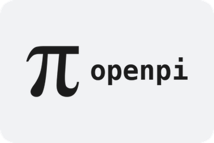
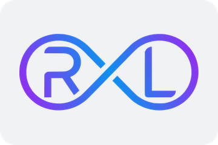
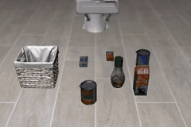
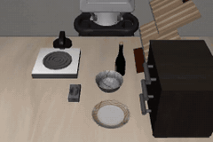
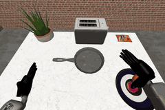
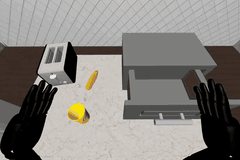
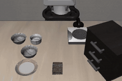
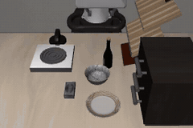

# hiVLA: A Unified Serving Layer for Deploying Diverse VLA Models

<div align="center">

**Author:** [The Humanoid Intelligence Team](https://humanoidintelligence.github.io)

[OpenMOSS Group](https://openmoss.ai) / [Shanghai Innovation Institute](https://www.sii.edu.cn/) / [Fudan University](https://www.fudan.edu.cn/en/)

[English](./README.md) | **简体中文** · **文档：** [模型系列](docs/families/README.zh-CN.md) · [API 参考](docs/api.zh-CN.md) · [更新日志](CHANGELOG.zh-CN.md) · [贡献指南](CONTRIBUTING.md)

<!-- families-gallery:start -->

<table>
<tr><td align="center"><a href="docs/families/lerobot.zh-CN.md"></a><br><sub>LeRobot</sub></td><td align="center"><a href="docs/families/openpi.zh-CN.md"></a><br><sub>openpi</sub></td><td align="center"><a href="docs/families/gr00t.zh-CN.md"></a><br><sub>GR00T</sub></td><td align="center"><a href="docs/families/starvla.zh-CN.md"></a><br><sub>StarVLA</sub></td><td align="center"><a href="docs/families/xpolicylab.zh-CN.md"></a><br><sub>XPolicyLab</sub></td><td align="center"><a href="docs/families/rlinf.zh-CN.md"></a><br><sub>RLinf</sub></td><td align="center"><a href="docs/families/pokebot.zh-CN.md"></a><br><sub>PokeBot</sub></td></tr>
<tr><td align="center"><a href="docs/families/lerobot.zh-CN.md"></a><br><sub>LIBERO</sub></td><td align="center"><a href="docs/families/openpi.zh-CN.md"></a><br><sub>LIBERO</sub></td><td align="center"><a href="docs/families/gr00t.zh-CN.md"></a><br><sub>RoboCasa GR-1</sub></td><td align="center"><a href="docs/families/starvla.zh-CN.md"></a><br><sub>RoboCasa GR-1</sub></td><td align="center"><a href="docs/families/xpolicylab.zh-CN.md"></a><br><sub>RoboCasa GR-1</sub></td><td align="center"><a href="docs/families/rlinf.zh-CN.md"></a><br><sub>LIBERO</sub></td><td align="center"><a href="docs/families/pokebot.zh-CN.md"></a><br><sub>LIBERO</sub></td></tr>
</table>

<!-- families-gallery:end -->

</div>

<!-- toc -->

<details>
<summary><b>目录</b></summary>

- [简介](#简介)
- [支持的模型](#支持的模型)
- [快速开始](#快速开始)
  - [不装模型先试一下](#不装模型先试一下)
  - [为真实模型安装](#为真实模型安装)
  - [完整示例：在 Fourier GR-1 上部署 GR00T N1.6](#完整示例在-fourier-gr-1-上部署-gr00t-n16)
  - [驱动 hiRobot 机器人](#驱动-hirobot-机器人)
- [架构](#架构)
- [仓库结构](#仓库结构)
- [性能](#性能)
  - [A. 单个服务](#a-单个服务)
  - [B. 多个服务放在 `hivla route` 后面](#b-多个服务放在-hivla-route-后面)
- [添加新模型](#添加新模型)
- [联系方式](#联系方式)
- [引用](#引用)
- [许可证](#许可证)

</details>

<!-- /toc -->

## 简介

hiVLA 通过网络部署视觉-语言-动作（VLA）模型。把它指向一个 checkpoint，启动 `hivla serve`，
机器人一侧的调用方发来观测（关节状态、相机图像、一条指令），拿回一段可以执行的动作，即 action chunk。
所有和模型相关的处理都在服务端完成：缩放图像、归一化、分词、前向推理、反归一化，以及把输出拆成机器人
认识的动作字段。

- **多种模型系列，一个接口。** LeRobot、openpi（π₀ / π₀.₅）、GR00T、StarVLA、XPolicyLab 和 RLinf 的模型都用
  同一种请求和回复格式，换模型时调用方不用改。`generic` 系列部署普通的 torch / ONNX / TensorRT checkpoint，
  接入一个新系列只需写一个 adapter 类。
- **一个模型一个环境，替你启动。** 每个系列在自己的环境里保留自己的 torch / jax 版本；`hivla launch` 在任何
  环境下都能用那个环境的 Python 把服务起起来。
- **适配多机器人统一接口 hiRobot。** 请求和回复使用 [hiRobot](https://github.com/humanoidintelligence/hiRobot) 的
  `Observation` 和 `ActionChunk` 字段，模型和机器人通过同一个接口对接。同一个 VLA 可以服务多款机器人，每款机器人一份
  配置，写明它的状态布局和动作宽度：XPolicyLab 的 `demo_policy` 自带 Unitree G1 和双臂 UR5e 两份配置。同一台机器人
  也可以调用多款 VLA：RoboCasa 里的 Fourier GR-1 经 hiRobot 跑过 GR00T N1.6 和 StarVLA QwenGR00T。
- **更快的推理服务。** 把并发请求动态合批；观测重复时直接重放上一段 chunk 的缓存；`torch.compile`；
  以及异步引擎，在机器人执行当前 chunk 时预测下一段。
- **多块 GPU，一个地址。** `hivla route` 在一组服务进程之间做负载均衡（round-robin、least-outstanding，
  或为了缓存命中用 consistent-hash）；某个后端挂掉时立刻返回错误，调用方不会卡住。

hiVLA 负责部署模型。装了 [hiRobot](https://github.com/humanoidintelligence/hiRobot) 时，`hivla.robot.run_episode`
还能把部署好的模型跑在机器人上，仿真或真机都行；它只是一个最小的循环，完整的 agent 循环在 hiAgent 里。

> [!NOTE]
> **配套项目。**
> [hiRobot](https://github.com/humanoidintelligence/hiRobot) 是机器人一侧：用一个接口控制不同的机器人，
> 读取观测并检查每一条命令。hiVLA 的请求和回复使用 hiRobot 的 `Observation` 和 `ActionChunk` 字段名；
> 只有 `hivla.robot` 在被调用时才导入 hiRobot。
> [hiWBC](https://github.com/humanoidintelligence/hiWBC) 在 hiRobot 下面负责全身平衡和行走。
> [hiAgent](https://github.com/humanoidintelligence/hiAgent) 是 agent 操作层，在自己的循环里通过
> `hivla.client` 调用 hiVLA，再把返回的 chunk 在 hiRobot 上执行。

> [!WARNING]
> **状态：早期开发阶段。** API 不稳定，可能会变。
>
> **真机安全。** hiVLA 输出的 action chunk 经由 hiRobot（从 `hivla.robot` 或 hiAgent 发出）到达机器人，而软件控制下的机器人
> 可能伤人，也可能损坏自身。在硬件上运行之前，请仔细阅读本仓库，以及 hiRobot 中对应机器人的
> [配置指南](https://github.com/humanoidintelligence/hiRobot/tree/main/docs/setup)。
> 先在仿真里调通，再一步步上真机：先只读，再把机器人吊在龙门架上、用低增益运行，急停按钮放在手边，
> 机器人够得着的范围内不要站人。

## 支持的模型

每个系列都用模型自己的代码和前后处理来运行模型，所以结果和原始发布一致。hiVLA 在外面加一个统一的入口。

| 系列 | 模型 | 内置配置 | 已验证 | 指南 |
| --- | --- | --- | --- | --- |
| `generic` | 任意 torch / ONNX / TensorRT checkpoint | `example` | | [generic](docs/families/generic.zh-CN.md) |
| `lerobot` | LeRobot **v0.6.2** 的单帧观测 policy，例如 ACT | `lerobot_act_aloha` | ACT ALOHA：HTTP / WS 下 chunk 形状正确 | [lerobot](docs/families/lerobot.zh-CN.md) |
| `openpi` | Physical Intelligence 的 π₀、π₀.₅、π₀-FAST | `openpi_pi05_libero` | π₀.₅ LIBERO：4 个 suite 平均 97.05%（openpi：96.85%） | [openpi](docs/families/openpi.zh-CN.md) |
| `gr00t` | NVIDIA GR00T **N1.6** / N1.7 | `gr00t_n1d6_gr1` | N1.6 RoboCasa GR-1：10 集成功 5 集 | [gr00t](docs/families/gr00t.zh-CN.md) |
| `starvla` | StarVLA `baseframework` checkpoint（QwenGR00T、QwenOFT 等） | `starvla_qwengr00t_gr1` | QwenGR00T RoboCasa GR-1：50 集成功 37 集（StarVLA：0.58–0.74） | [starvla](docs/families/starvla.zh-CN.md) |
| `xpolicylab` | 任意 XPolicyLab policy（有状态） | `xpolicylab_demo_g1` | `demo_policy` 在 MuJoCo G1 上 | [xpolicylab](docs/families/xpolicylab.zh-CN.md) |
| `rlinf` | RLinf 用 PyTorch 重新实现的 π₀ / π₀.₅ | `rlinf_pi05_libero` | Pi05-LIBERO-SFT 跑过 LIBERO spatial | [rlinf](docs/families/rlinf.zh-CN.md) |
| `pokebot` | Pokebot 云端 RoboAPI 模型 `poke-aurora`（有状态，本地无权重） | `pokebot_aurora` | 真实请求一轮：1.7 s 返回 (40, 8) 位姿 | [pokebot](docs/families/pokebot.zh-CN.md) |

每篇指南讲环境、配置项、观测字段怎样送进模型、输出怎样变回 chunk，以及常见问题。通用流程见
[模型系列总览](docs/families/README.zh-CN.md)。

## 快速开始

### 不装模型先试一下

`echo` 后端返回全零的 action chunk，所以不需要 checkpoint、GPU 或深度学习框架，就能试用服务端和客户端：

```bash
git clone https://github.com/humanoidintelligence/hiVLA.git && cd hiVLA
pip install -e ".[server,client]"
hivla serve --config echo_example         # HTTP + WebSocket on :8000
```

在另一个终端里：

```bash
curl localhost:8000/health      # {"status":"ok"}
curl localhost:8000/metadata    # what the model expects and returns
```

```python
import numpy as np
from hivla.client import VlaClient

client = VlaClient("http://localhost:8000")
client.reset()                  # fetches /metadata into client.metadata
chunk = client.act({
    "joint_pos": np.zeros(7, np.float32),
    "images": {"head": np.zeros((224, 224, 3), np.uint8)},
    "instruction": "pick up the cube",
})
print(chunk["mode"], chunk["joint_targets"].shape)   # position (16, 7)
```

`VlaWsClient` 提供同样的方法，走一条持久的 WebSocket 连接。`reset()` 同时在服务端开始一个 episode，
有状态的模型（XPolicyLab）在第一次 `act` 之前需要它。观测字段和 chunk 字段列在
[API 参考](docs/api.zh-CN.md#线协议)里。

### 为真实模型安装

每个模型系列都锁定了自己的 torch / transformers 版本，而且互相冲突。所以 hiVLA 不自带深度学习框架：
你把它作为一个轻量库**装进模型自己的环境**，每个模型跑一个服务进程。按需选择 extra：

| Extra | 增加的内容 |
| --- | --- |
| `server` | `hivla serve` 和 `hivla route`（FastAPI、uvicorn） |
| `client` | `hivla.client` 和 `remote` 后端（httpx、websockets） |
| `torch` / `onnx` / `tensorrt` | `generic` 系列的各个后端 |
| `vision` | 用 Pillow 缩放图像 |
| `dev` | pytest 和 ruff |

服务不一定要在模型的环境里启动。`hivla launch` 读配置里的 `launch.env`（conda 环境名、环境目录或 Python
路径），检查那个环境里能 import hiVLA、端口没被占用，再用那个 Python 启动 `hivla serve`，等到 `/health`
应答为止：

```yaml
launch:
  env: gr00tn1d6           # the model's environment
  ready_timeout: 600       # seconds to wait for /health
```

```bash
hivla launch --config <model>             # from any env with hiVLA
```

每个系列的环境和 checkpoint 见它的[指南](docs/families/README.zh-CN.md)。

### 完整示例：在 Fourier GR-1 上部署 GR00T N1.6

从全新 clone 开始，为 Fourier GR-1 人形机器人（embodiment tag `gr1`）部署 NVIDIA 的 GR00T N1.6-3B。

**1. 装进 GR00T 环境。** 按 [Isaac-GR00T](https://github.com/NVIDIA/Isaac-GR00T) n1.6 的说明配好环境
（Python 3.12、torch 2.7.1+cu128），再把 Eagle backbone 需要的 `flash-attn` 和 hiVLA 装进同一个环境：

```bash
git clone https://github.com/humanoidintelligence/hiVLA.git && cd hiVLA
conda activate gr00tn1d6                              # your GR00T environment
pip install flash-attn --no-build-isolation          # the Eagle backbone needs it
pip install -e ".[server,client]"
```

**2. 从 Hugging Face 下载 checkpoint。** GR00T 的 VLM backbone 需要申请权限，所以先在
[`nvidia/GR00T-N1.6-3B`](https://huggingface.co/nvidia/GR00T-N1.6-3B) 申请访问，并用 `hf auth login` 登录：

```bash
export HIVLA_MODELS=/path/to/your/models
hf download nvidia/GR00T-N1.6-3B --local-dir $HIVLA_MODELS/Isaac-GR00T-n1.6/checkpoints/GR00T-N1.6-3B
```

`src/hivla/configs/gr00t_n1d6_gr1.yaml` 从 `${HIVLA_MODELS}` 读取 checkpoint 路径。配置会展开 `~`、`$VAR`、`${VAR}`
和 `${VAR:-default}`，所以里面没有和机器相关的路径。没设置、又没有默认值的变量会直接报错，路径不会
悄悄指到错误的地方。

**3. 先检查配置，再启动服务。** `hivla inspect` 解析配置但不加载权重：

```bash
hivla inspect --config gr00t_n1d6_gr1     # prints what will be served
hivla serve   --config gr00t_n1d6_gr1     # loads GR00T on the GPU, listens on :8000
```

**4. 确认它能应答**，在另一个终端里：

```bash
curl localhost:8000/health        # {"status":"ok"}
curl localhost:8000/metadata      # action_dim 29, cameras, action_horizon, ...
```

不启动服务也可以测试模型：`scripts/smoke_gr00t_n1d6.py` 在进程内加载模型，发送合成的观测，检查每段
chunk 的形状（`--http` / `--ws` 会走一个它自己起的本地服务）：

```bash
python scripts/smoke_gr00t_n1d6.py --config gr00t_n1d6_gr1 --iters 10
```

**5. 用它驱动机器人**，用 `hivla.robot`（见下一节），或通过 hiAgent：把 hiAgent 机器人配置里的
`vla.endpoint` 设为 `http://<host>:8000`。见 hiAgent 的[快速开始](https://github.com/humanoidintelligence/hiAgent#quick-start)。

其他系列的用法相同，各自在自己的环境里，各有自己的内置配置（`hivla configs` 列出全部），步骤见各自的
[指南](docs/families/README.zh-CN.md)。每份配置从一个必须设置的环境变量读取 checkpoint：`gr00t` 和 `starvla` 用 `${HIVLA_MODELS}`，`openpi` 用 `${OPENPI_DATA_HOME}`，
`rlinf` 用 `${RLINF_CKPT}`（它的 tokenizer 还要 `${OPENPI_DATA_HOME}`）。

### 驱动 hiRobot 机器人

`hivla.robot.run_episode` 把部署好的模型跑在一个 hiRobot `Robot` 上。机器人那边的环境只需要 hiRobot 和
`hivla[client]`，不需要模型的任何包：

```python
from hirobot import make_robot
from hivla.client import VlaWsClient
from hivla.robot import run_episode

robot = make_robot("unitree_g1_mujoco", sim=True)
result = run_episode(robot, VlaWsClient("http://127.0.0.1:8012"), max_steps=100,
                     instruction="wave")
print(result.steps, result.chunks, result.stopped_by)   # 100 50 max_steps
```

它先 reset 机器人和服务端，要一段 chunk，用 `send_action` 逐步发出，执行完服务端的 `n_action_steps` 后再要
下一段。对每执行一步都要读观测的模型（`/metadata` 里 `observe: every_step`），它在之后的每一步前发一次
`observe`。真机按 `control_hz` 定速，仿真能跑多快就跑多快。出异常时先让机器人 `hold()`，再抛出错误。

不用权重也能试：为 MuJoCo G1 部署 XPolicyLab 的 `demo_policy`（`src/hivla/configs/xpolicylab_demo_g1.yaml`，见
[XPolicyLab 指南](docs/families/xpolicylab.zh-CN.md)），再在 hiRobot 的环境里运行上面的代码。

## 架构

调用方发来一份原始的观测，拿回一段可以直接执行的 action chunk。所有和模型相关的处理都在服务端完成，
openpi 和 GR00T 自己部署时也是这样划分的。换模型时调用方的客户端不用改，而且它只需要 numpy 和一个
HTTP / WebSocket 库（`hivla[client]`），不需要模型的任何依赖。

![hiVLA 架构图，画法像一台服务器：模型在上，调用方在下，请求从下往上走。最上面是模型代码（lerobot、openpi、Isaac-GR00T、starVLA、XPolicyLab、RLinf）和后端加载的 checkpoint。hiVLA 内部从上往下：ModelBackend（原生系列 lerobot、openpi、gr00t、starvla、xpolicylab、rlinf，各在自己的环境里，或跑在 runtime torch、onnx、tensorrt、echo、remote 上的 generic）；VlaPolicy（输入 transform ConcatState、RenameKeys 和系列自己的 transform，然后是后端，再是系列自己的输出 transform、RenameKeys、GripperToOpening，最后按 hiRobot 的 ActionChunk 规则检查 chunk）；InferenceEngine（观测缓存、动态合批，有状态模型一次服务一个会话）；Server（/act、/reset、/observe、/ws、/metadata、/health，可选 api_key）；网络（JSON 或 msgpack，不用 pickle）；以及在调用方一侧的 hivla.client（只依赖 numpy；hivla.robot 用它驱动 hiRobot 的 Robot）。右边，configs/*.yaml（路径或内置名字）变成 ModelSpec、FamilyAdapter 和 build_engine，由它搭起整个栈；旁边是 /metadata、hivla.protocol、hivla inspect 和 AsyncInferenceEngine。左边是每个系列一个环境（hivla launch 从任意环境启动它），以及放在一组服务前面的可选网关 hivla route。最下面，hiAgent 通过网络把观测发给 hiVLA、拿回 action chunk，并在同一进程里和 hiRobot 交换 Action 和 Observation；hiVLA 遵循 hiRobot 的字段名和规则，但不导入它。](assets/architecture.png)

按请求经过的顺序，从下往上看这张图：

1. **`hivla.client`**（HTTP 用 `VlaClient`，WebSocket 用 `VlaWsClient`）把观测编码后发出去，格式是 JSON
   （数组用 base64）或 msgpack（数组是原始字节）。全程不用 pickle。
2. **`Server`** 在 `/act` 或 `/ws` 上接收请求。`/metadata` 告诉调用方模型要什么、返回什么（相机、状态布局、
   关节名、action horizon、是否有状态），`/health` 用于探活。`/reset` 开始一个 episode，`/observe` 把一帧
   观测交给有状态的模型、不要 chunk。设置了 `server.api_key` 后，`/act`、`/reset` 和 `/observe` 要求带上
   密钥；`/ws` 目前还不检查，所以端口要放在可信的网络里。
3. **`InferenceEngine`** 在观测重复时重放缓存的 chunk，并把并发请求合成一个批次。对有状态的模型，它改为
   一次只服务一个会话：最后调用 `reset` 的那个（HTTP 客户端的 `X-Hivla-Session` 头，或一条 WebSocket 连接）。
   `AsyncInferenceEngine` 是在进程内使用的版本，在后台预测下一段 chunk。
4. **`VlaPolicy`** 依次运行输入 transform、后端、输出 transform，最后检查这段 chunk 是 hiRobot 能执行的：
   控制模式合法、形状一致、只有一个 horizon。
5. **`ModelBackend`** 运行模型：用系列自己的流水线，或者对 `generic` 用 torch / ONNX / TensorRT 会话。
   `echo` 返回全零，`remote` 转发给另一台 hiVLA 服务。

一份 YAML 配置就能搭起整个栈：它被解析成 **`ModelSpec`**，spec 里的系列选出一个 **`FamilyAdapter`**
（决定用哪个后端和哪些 transform），再由 `build_engine` 组装上面这几层。

核心概念：

| 概念 | 职责 |
| --- | --- |
| `ModelSpec` | 一个部署模型的全部描述：系列、checkpoint、后端、action horizon、归一化统计量、transform。由 YAML 配置构建。 |
| `FamilyAdapter` | 一个模型系列特有的部分：怎么加载、怎么运行，以及它的字段怎么和 hiRobot 的字段对应。 |
| `ModelBackend` | 运行一种模型格式（`echo` / `torch` / `onnx` / `tensorrt` / `remote`，或某个系列自己的流水线）。输入数组，输出数组。 |
| `Transform` | 一步 `dict -> dict` 的处理（重命名、归一化、填充、切片、sin/cos 编码、缩放），串成输入和输出两条流水线。 |
| `VlaPolicy` | 运行输入 transform、后端和输出 transform，然后检查 chunk。 |
| `InferenceEngine` | 部署时持有 policy：预热、重复观测缓存、动态合批。`AsyncInferenceEngine` 在后台 worker 里预测。 |
| `Server` | 通过 HTTP（`/act`、`/reset`、`/observe`、`/metadata`、`/health`）和 WebSocket（`/ws`）对外提供引擎，两者用同一种线协议。 |

## 仓库结构

```
hiVLA/
├── src/hivla/
│   ├── client.py            # VlaClient / VlaWsClient（不依赖模型）
│   ├── protocol.py          # 线协议（JSON + base64，或 msgpack）
│   ├── robot.py             # run_episode：让 hiRobot Robot 对接一个服务
│   ├── cli.py               # `hivla serve` / `launch` / `inspect` / `route` / `configs`
│   ├── core/
│   │   ├── spec.py          # ModelSpec：一个部署的模型
│   │   ├── config.py        # 按路径或内置名字读配置，展开 ${VAR}
│   │   ├── transforms.py    # Transform 步骤
│   │   ├── policy.py        # VlaPolicy：输入 transform → 后端 → 输出 transform → chunk 检查
│   │   └── build.py         # 配置 → ModelSpec → 后端 → policy → 引擎
│   ├── serving/
│   │   ├── engine.py        # InferenceEngine / AsyncInferenceEngine：缓存、合批、会话
│   │   ├── server.py        # FastAPI 应用：/act、/reset、/observe、/metadata、/health、/ws
│   │   ├── router.py        # `hivla route` 和它的路由策略
│   │   └── launch.py        # `hivla launch`：用模型自己环境的 Python 启动服务
│   ├── runtimes/            # 按 checkpoint 格式运行（`generic` 用）
│   │   ├── base.py          # ModelBackend 接口
│   │   ├── echo.py          # 无依赖的测试后端
│   │   ├── torch.py, onnx.py, tensorrt.py
│   │   └── remote.py        # 转发给另一台 hiVLA 服务
│   ├── families/            # 每个模型系列一个文件：它的 adapter 和后端
│   │   ├── base.py          # FamilyAdapter 接口
│   │   ├── generic.py       # hiVLA 经 runtime 加载 checkpoint
│   │   ├── lerobot.py, openpi.py, gr00t.py, starvla.py, xpolicylab.py, rlinf.py
│   │   ├── pokebot.py       # 通过 HTTP 调 Pokebot 云端 RoboAPI
│   │   └── native.py        # 给任何带 obs -> action 工厂函数的包用的 adapter
│   └── configs/             # 内置配置，每个部署的 checkpoint 一份（`hivla configs`）
├── scripts/
│   ├── smoke_gr00t_n1d6.py, smoke_lerobot_act.py  # GPU 冒烟测试（进程内或走网络）
│   └── fetch_parallel.py    # 并行下载 checkpoint
├── tests/                   # pytest 测试；模型系列都是假的，不需要 GPU
├── docs/
│   ├── api.md               # API 参考
│   └── families/            # 每个模型系列一篇指南
│                            # （都有中文版 *.zh-CN.md）
├── CHANGELOG.md             # 每个版本的变化（中文：CHANGELOG.zh-CN.md）
└── CONTRIBUTING.md          # 每类改动需要什么
```

每个版本改了什么见 [CHANGELOG.zh-CN.md](CHANGELOG.zh-CN.md)。

## 性能

下面分别测两件事：**(A)** 一个服务进程在一块 GPU 上跑模型有多快，**(B)** 一组服务放在 `hivla route`
后面能扩展到什么程度。两者都用合成的压测程序（不跑仿真器），在一块数据中心 GPU 上测 GR00T N1.6-3B（`gr1`），
每个请求带 29 维状态和一帧 256×256 图像，所以数字反映的是服务栈本身，而不是仿真耗时。

### A. 单个服务

一个 `hivla serve`，400 个请求。耗时主要在推理（基线约 211 ms 一个请求；解码和编码都不到 1 ms），
所以有用的是更快的前向推理，以及并发请求怎样送进模型。

| 方案 | 负载 | 吞吐（req/s） | p50 (ms) | p99 (ms) |
| --- | --- | --- | --- | --- |
| 基线（batch 1） | 串行 | 6.7 | 125 | 219 |
| `torch.compile`（DiT head） | 串行 | 8.9 | 90 | 189 |
| 并发 16，不合批 | 16 个在途 | 6.6 | 2404 | 2516 |
| 并发 16，动态合批 | 16 个在途 | **44.4** | 319 | 669 |
| 重复观测缓存（80% 命中） | 串行 | 29.7 | **1.7** | 219 |

对 DiT head 做 `torch.compile` 带来的单请求收益最大：前向推理从 211 ms 降到 62 ms。并发时，动态合批把吞吐
从 6.7 提到 44 req/s；不合批的话，并发请求只能排队等模型，只会增加延迟。缓存回答一份重复观测约 1.7 ms，
控制循环重发同一帧时有用。JSON 和 msgpack 在这里差不多，因为推理耗时远大于传输。

### B. 多个服务放在 `hivla route` 后面

四个 `hivla serve` 后端，每块 GPU 一个，放在一个 router 后面，保持 32 个请求在途。

| 路由策略 | 吞吐（req/s） | p50 (ms) | p99 (ms) |
| --- | --- | --- | --- |
| round-robin | 26.0 | 1266 | 1894 |
| least-outstanding | 26.2 | 1234 | **1320** |
| consistent-hash | 24.9 | 1174 | 2684 |

least-outstanding 会把请求从忙的后端引开，所以尾延迟最低。扩展接近线性：这个负载下一个后端撑住 6.4 req/s，
四个撑住 26.0 req/s（**4.1×**）；router 只转发字节。运行中途杀掉一个后端，路由到它的请求立刻收到 `502`
（23 s 内 600 个请求中有 134 个，没有一个卡住），另外三个照常服务。

## 添加新模型

1. **为 checkpoint 写一份配置**，从 `src/hivla/configs/example.yaml` 开始：系列、checkpoint 路径、action horizon，
   以及 `policy` 下的动作宽度、控制模式和相机。`hivla inspect --config ...` 不加载权重就能显示它解析成什么。
2. **有合适的现成系列就直接用。** `generic` 部署普通的 torch / ONNX / TensorRT checkpoint，用你的 `norm_stats`
   归一化。其他具名系列运行模型自己的代码，从 `native_kwargs` 读取加载选项，各项见它们的
   [指南](docs/families/README.zh-CN.md)。
3. **否则注册一个 `FamilyAdapter`。** 它返回运行模型的后端，以及把 hiRobot 字段名映射到模型字段名（和反向映射）
   的输入 / 输出 `Transform` 列表。不需要继承 `VlaPolicy`。示例见[模型系列](docs/api.zh-CN.md#模型系列)，
   再照现有的指南在 `docs/families/` 下写一篇。请求之间要保留状态的模型在后端上设置 `stateful`（见
   [XPolicyLab 指南](docs/families/xpolicylab.zh-CN.md)）。

如果模型的输入或输出和 hiRobot 的约定不同，两个配置项能覆盖常见情况。`policy.state_layout` 把观测字段
（关节位置、夹爪、末端执行器位姿）拼成模型训练时用的状态向量。`policy.gripper_range` 把模型的夹爪值映射成
hiRobot 的夹爪开合度（0 闭合，1 张开）。

测试把每个模型系列都换成了假的，所以不需要 GPU 或模型权重就能跑：

```bash
pip install -e ".[dev]"
pytest
```

提 pull request 前请阅读 [CONTRIBUTING.md](CONTRIBUTING.md)：每类改动需要什么，以及怎么说明你实际跑了什么。

## 联系方式

- [Peng Li](https://artpli.github.io)：pengli.ds [at] gmail.com

## 引用

如果你在研究中用到了 hiVLA，请引用：

```bibtex
@misc{hivla,
  title  = {hiVLA: A Unified Serving Layer for Deploying Diverse VLA Models},
  author = {Li, Peng and Zhang, Yifei and Zhang, Haozhe and Qiu, Xipeng},
  year   = {2026},
  url    = {https://github.com/humanoidintelligence/hiVLA}
}
```

## 许可证

[Apache License 2.0](LICENSE)。完整条款见 [LICENSE](LICENSE)。

